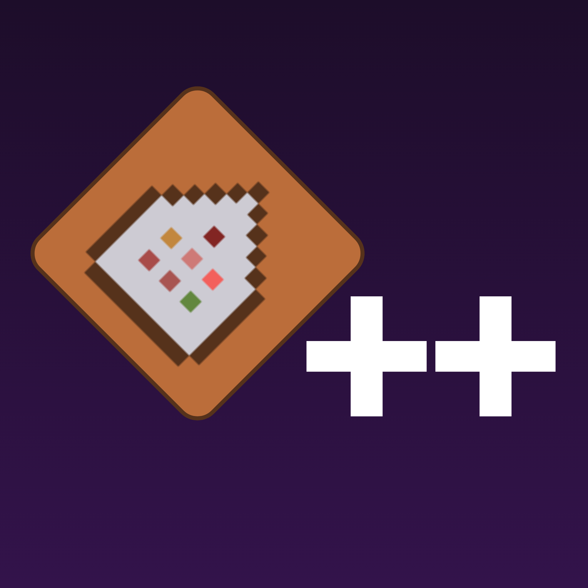

	<h1>
		Commands++
	</h1>
	<h4>Minecraft Bedrock Command Extension Addon</h4>

 

## Welcome

Commands++ is a Minecraft Bedrock addon that extends the capabilities of vanilla commands. It allows you to use features from the Script API, while still staying fairly close to the vanilla style command syntax

## Wiki

Read more about the commands on our [wiki](https://jeanmajid.github.io/MCPE-Commands-plus-plus/) (Currently a WIP)

## TODO

The todo is under the [Issues](https://github.com/jeanmajid/MCBE-Commands-plus-plus/issues), categorized by **New Feature** and/or **Change** and what exactly it is, so either **Command**, **Attribute**, **Gamerule**, **Wiki** or **Documentation**

## Contributing

We welcome contributions. If you have a suggestion or found a bug, please open an issue on our [GitHub page](https://github.com/jeanmajid/MCBE-Commands-plus-plus/issues). If you know how to code you can gladly open a pull request. Full AI code is discouraged and will likely be denied

This Project uses [MCPE-Tool](https://github.com/jeanmajid/MCPE-Tool) for development, install the tool and run `mc watch` to get the addon into your game

<!-- TODO: More info under the wiki bla bla bla -->

## License & Disclaimer

This is not an official Minecraft product. It is not approved by, affiliated with, or associated with Mojang or Microsoft.

**License:** This project is licensed under the [PolyForm Noncommercial License 1.0.0](https://polyformproject.org/licenses/noncommercial/1.0.0). Please refer to the [`LICENSE`](./LICENSE) file for the full license terms.

Commands++ is an independent project maintained by jeanmajid.

Copyright in individual contributions remains with their respective copyright holders.

**Commercial use requires prior written authorization from the applicable copyright holder.** To inquire about commercial licensing for Commands++, contact jeanmajid through the [project's GitHub repository](https://github.com/jeanmajid/MCPE-Commands-plus-plus).

	<h2>Contributors</h2>
	

